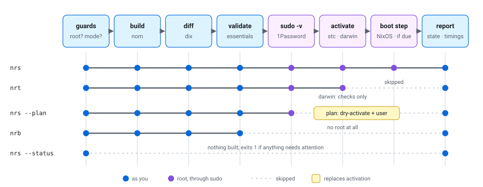
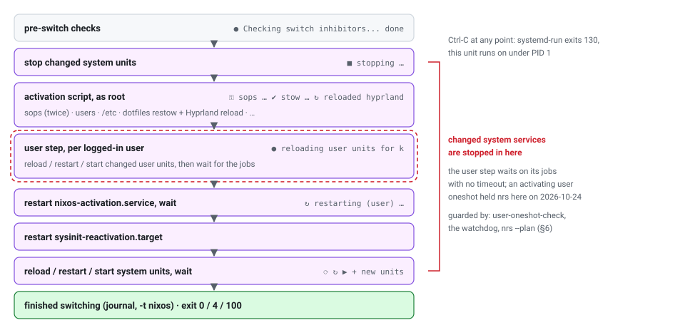
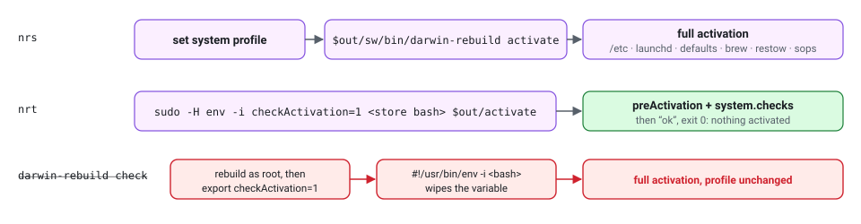
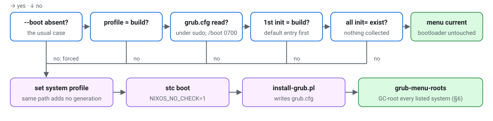
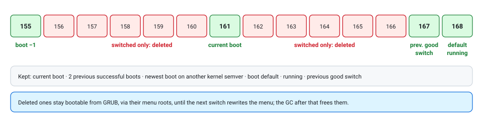

# nrs: the rebuild helper

The manual for `nrs`, `nrb` and `nrt`, the one script that builds and switches
nebula (NixOS) and the Macs (nix-darwin). It covers what each command and mode
does, the order of every stage, what the output means, the machinery around it
that keeps switching safe, and what to do when something looks wrong.

> [!NOTE]
> **Verified 2026-10-24** against `pkgs/nrs.sh` as of commit `b95c62b`, and by
> running it:
> - on **nebula**: NixOS, nixpkgs `3ec6363`, Determinate Nix 3.24.0
>   (Nix 2.35.3), systemd 262, GRUB;
> - on **k**: nix-darwin `bb0b90d`.
>
> nrs replaced nh that day; until then it ran beside nh as `nrs2`. The
> analysis that led to it is in git: `git show b95c62b:docs/nrs-pipeline.html`.
> Its finding and proposal numbers (F1–F12, P1–P17) still appear in code
> comments, and [§10](#10-origins-f1f12-and-p1p17) maps them.
>
> This page is for browsing on GitHub. The same manual, styled for reading,
> with a theme toggle, is [`nrs-pipeline.html`](nrs-pipeline.html). The diagrams
> here are exported from it by
> [`nrs-pipeline/export-svgs.ts`](nrs-pipeline/export-svgs.ts).

## Contents

1. [Commands at a glance](#1-commands-at-a-glance)
2. [The pipeline and its modes](#2-the-pipeline-and-its-modes)
3. [Stage by stage](#3-stage-by-stage)
4. [Reading the output](#4-reading-the-output)
5. [Modes in depth](#5-modes-in-depth)
6. [What keeps switching safe](#6-what-keeps-switching-safe)
7. [Troubleshooting](#7-troubleshooting)
8. [Learned behaviours & workarounds](#8-learned-behaviours--workarounds)
9. [Files and decisions](#9-files-and-decisions)
10. [Origins: F1–F12 and P1–P17](#10-origins-f1f12-and-p1p17)

## 1. Commands at a glance

Run all of these as yourself, never under `sudo`. nrs builds as you and asks
sudo only for the root steps, which the 1Password agent approves. Under sudo it
refuses with exit 2.

| Command | What it does | Root step | OS |
| --- | --- | --- | --- |
| `nrs` | Build, diff, validate, activate, make it the boot default, report. | yes | both |
| `nrb` = `nrs --dry` | Build, diff and validate only. The report compares the kernel and PAM against the new build. | no | both |
| `nrt` = `nrs --test` | **NixOS:** activate without touching the profile or GRUB. **darwin:** run the new build's `system.checks`; nothing is activated. | yes | both |
| `nrs --plan` | Preview the switch and change nothing: `dry-activate` for system units, plus the user units it skips. Flags units the switch would restart while they're mid-run. | yes | NixOS (darwin: acts as `--dry`) |
| `nrs --status` | No build, no root: is the machine consistent? Exits 1 if anything needs attention. | no | both |
| `nrs --boot` | Switch, and rewrite the boot menu even when it's already current. | yes | NixOS |

- **Modes don't combine.** `--dry`, `--test`, `--plan` and `--status` are
  mutually exclusive (exit 2). `--boot` warns and is ignored with any mode, and
  on darwin.
- **Extra arguments go to `nix build`,** for example `nrs -L` or
  `nrb --show-trace`. `--status` takes none (exit 2).
- **The flake** is `~/src/dotfiles`, resolved with `readlink -f`: nix's
  `--flake <path>` doesn't follow a path that is itself a symlink, as it is on
  nebula. **The host** is `uname -n` on NixOS and
  `scutil --get LocalHostName` on darwin, as nh and darwin-rebuild use.

A real `nrs` on nebula with nothing to change:

```text
> building nebula from /home/k/src/github/kriswill/dotfiles
Finished at 22:18:11 after 0s
> changes: /run/current-system → 3wxfn4p91a3i…-nixos-system-nebula-26.11.20261023.3ec6363
PATHS: 3168 -> 3168 (+0, -0)    SIZE: 28.1 GiB -> 28.1 GiB    DIFF: 0 bytes
> authenticating for activation
> activating: switch-to-configuration test, as nrs-switch-to-configuration.service
  ● Checking switch inhibitors... done
  switching to system configuration /nix/store/3wxfn4p91a3i…
  ● activating the configuration
  ⚿ sops  keys  rsa → GPG 646fb041…c17120 · ed25519 → age age1vn8h…chjzrz
  ● setting up /etc
  ✔ stow  22 packages · 165 links · 8 skipped (darwin-only) · 0.41s
  ↻ reloaded hyprland
  ● reloading user units for k
  ↻ restarting (user) nixos-activation.service
  ● restarting sysinit-reactivation.target
  + new units  libvirtd.service, NetworkManager-dispatcher.service
  finished switching to system configuration /nix/store/3wxfn4p91a3i…
> boot menu is current (gen 168 is the default, no collected generations listed); bootloader untouched (--boot rewrites it)

── state ──
  booted        gen 161
  running       gen 168
  boot default  gen 168
── timings ──
  build         0.06s
  diff          0.04s
  auth          0.05s
  activate      2.56s
done
```

## 2. The pipeline and its modes

Every run walks the same stages in the same order, the order nh used. The modes
are early exits from that one path. Blue stages run as you; purple ones are the
root steps behind `sudo`.

<picture>
  <source media="(prefers-color-scheme: dark)" srcset="nrs-pipeline/modes.dark.svg">
  
</picture>

*One path, five ways through it.* The guards run first in every mode. They
refuse root, refuse conflicting modes, and warn about a `--boot` that would do
nothing. The report runs last in every mode, including after every failure.
"stc" is `switch-to-configuration` throughout.

## 3. Stage by stage

### 1 · Build

`nom build "$flake#$attr" --out-link $tmp/result "$@"`, as you, with nom's live
build tree. The attribute is
`nixosConfigurations.<host>.config.system.build.toplevel`, or
`darwinConfigurations.<host>…`. The out-link in a private temp directory is the
only GC root for the new closure until the profile is set; it goes away when
nrs exits.

Before the build, on NixOS, any resume lists an interrupted switch left in
`/run/nixos/` or `/run/user/$UID/nixos/` are announced, so the replay this run
will do is no surprise.

### 2 · Diff

`dix /run/current-system $out`: the package-level changes, path count, size and
size delta. If dix fails, nrs warns and carries on.

### 3 · Validate

The build must contain its essentials, or nrs refuses to activate it:
- **NixOS:** `bin/switch-to-configuration`, `nixos-version`, `init` and
  `sw/bin`;
- **darwin:** `activate` and `sw/bin/darwin-rebuild`.

`nrb` stops here and reports.

### 4 · Authenticate

`sudo -v` once, up front, so a 1Password approval prompt doesn't interrupt the
activation output. Sudo authenticates through the 1Password SSH agent
(`pam_ssh_agent_auth`, auth-sufficient), and its timestamp covers every root
step that follows.

### 5 · Activate, NixOS

`switch-to-configuration test` runs as a **transient systemd unit**, the way
nixos-rebuild-ng does it:

```sh
sudo systemd-run --collect --no-ask-password --quiet --service-type=exec \
  --unit=nrs-switch-to-configuration --wait --verbose --output=cat \
  [-E LOCALE_ARCHIVE=…] [-E NIXOS_NO_CHECK=…] \
  $out/bin/switch-to-configuration test 2>&1 | render_activity
```

- **Detach, not kill.** Ctrl-C ends `systemd-run` (exit 130), and the switch
  runs on to completion under PID 1. A lost terminal does the same. nrs prints
  how to follow it (`journalctl -fu nrs-switch-to-configuration`) or stop it,
  reports, and exits 130. Re-run nrs afterwards to set the profile and boot
  entry.
- **One at a time.** stc takes its lock non-blocking, so if the unit from an
  earlier run is still active, nrs refuses to start another (exit 1).
- **Watchdog.** After 45 s of activation, and every 30 s after, it prints the
  pending system and user jobs. A stall names its unit instead of going silent.
  It never probes stc's lock, since that could make the real switch abort.
- **Exit codes.**
  - **0:** carry on.
  - **100:** the init interface changed and nothing was activated. nrs warns
    and still makes it the boot default, so a reboot brings it up.
  - **4:** activation finished but a unit failed. The profile and boot entry
    stay on the old generation, the same rule nh had.
  - **Anything else:** the same as 4, with that code.

Inside the unit, stc-ng works in this order. Your output shows each step as it
happens.

<picture>
  <source media="(prefers-color-scheme: dark)" srcset="nrs-pipeline/stc.dark.svg">
  
</picture>

*Why the restow and Hyprland reload come early, and `nixos-activation` late.*
The restow is a snippet of the root activation script, which runs before stc
touches any unit. `nixos-activation.service` is NixOS's per-user activation, run
as you. It runs `system.userActivationScripts`, which on nebula is only
`systemd-tmpfiles --user`. stc restarts it explicitly on every switch, after the
user units are up to date: system, then user units, then per-user activation.

### 5 · Activate, darwin

The order nh used: set the profile first, then run the **new** generation's own
`darwin-rebuild activate` under `sudo -H`. That script sets HOME, PATH and
NIX_REMOTE for root, and handles any legacy `activate-user`. There's no detach:
launchd has nothing like systemd-run wired in, so Ctrl-C interrupts activation
as it did under nh. Because the profile is already set, a failed activation
means "fix it and re-run nrs".

<picture>
  <source media="(prefers-color-scheme: dark)" srcset="nrs-pipeline/darwin.dark.svg">
  
</picture>

*Why `nrt` doesn't use `darwin-rebuild check`.* macOS splits shebang arguments,
so the activate script's `env -i` really runs and clears `checkActivation`. The
check-mode exit never fires. This was proven on `k`: the old `sudo nrt` did a
full activation. nrs runs the script through its own bash, the last word of the
shebang. The store bash is needed because the script uses bash 4 and `/bin/bash`
is 3.2. nrs refuses outright if the script has no check-mode exit. Decision:
[`nrs-darwin-check-mode`](../knowledge/decisions/nrs-darwin-check-mode.md).

### 6 · Boot step, NixOS

After a successful `test`, nrs makes the build the boot default. It sets the
system profile (`nix build --profile /nix/var/nix/profiles/system`), then runs
`switch-to-configuration boot` with `NIXOS_NO_CHECK=1`, because the pre-switch
checks already ran in `test`. It skips both when GRUB's own menu says there's
nothing to do. `nrt` never gets here.

<picture>
  <source media="(prefers-color-scheme: dark)" srcset="nrs-pipeline/boot.dark.svg">
  
</picture>

*Judged from GRUB's menu, not from a record of nrs's own.* A run cut off between
profile and bootloader, a menu another tool rewrote, or any GC since the menu
was written all lead to a rewrite. An unreadable or unfamiliar file does too,
which is the safe direction. If install-grub's entry format ever changes, the
check simply rewrites every time, no worse than nh. Decision:
[`nrs-boot-menu-check`](../knowledge/decisions/nrs-boot-menu-check.md).

### 7 · Report

Every exit ends with the state report, including failures, detaches and every
mode:

| Line | Meaning |
| --- | --- |
| booted · running · boot default | As generations (`gen N`), or a bare store name when no generation points at the build. If running ≠ boot default, it warns that a reboot would come back on the default. darwin keeps no `/run/booted-system`, so it shows two lines. |
| generations | `--status` only: how many there are, their range, and the oldest one's age, which is your rollback window. |
| detached unit · pending jobs | `--status` only, NixOS: a still-running `nrs-switch-to-configuration`, and queued system and user jobs. |
| plan lists | NixOS: resume lists left by an interrupted switch; the next run replays them. |
| failed units | NixOS: system and user. |
| kernel | NixOS: what a reboot would change. That means version, toolchain and `.config` (the new kernel's are read from its bzImage), kernel parameters, and the extra module packages. The running kernel describes itself through `/proc`; the new one is unpacked the way `extract-ikconfig` does it. |
| PAM glibc | NixOS: if the glibc that linux-pam links differs from the booted system's, reboot before logging out, because ly, started at boot, can't load the new PAM modules. |
| timings | Per stage: build, diff, auth, plan, activate, check, profile, boot. |

`--dry` and `--plan` compare the kernel and PAM against the **new build**: what
switching and then rebooting would change. Every other mode compares against
the running system.

## 4. Reading the output

Activation output streams live through a renderer. On a terminal it gets
glyphs, colour and an in-place progress line. Without one (piped, logged), the
same lines print without colour or animation. Lines the renderer doesn't
recognise pass through unchanged.

| You see | Source | Meaning |
| --- | --- | --- |
| `■` stopping · `⟳` reloading · `↻` restarting · `▶` starting · `+` new units | stc's plan | Units in each phase. `(user)` marks the user step. In `--plan` the same lines read "would stop", "would restart" and so on. |
| `·` not restarting (dim) | stc | Changed units with `restartIfChanged = false`, deliberately left alone. |
| `●` Checking …, setting up /etc, … (dim) | stc, activate | Progress lines. |
| `⠋ stow ████░░░░ 12/22 nvim` | restow events | Live while the dotfiles restow runs; it reports NDJSON on stderr. |
| `✔ stow 22 packages · 165 links · 8 skipped · 0.41s` | restow end | The summary. `⚠` instead of `✔` means some package conflicted. Listed under it: `↺` healed links, `✗` conflicts with stow's own message, `!` other stow output. |
| `↻ reloaded hyprland` | NixOS restow | Hyprland was told to reload its config. |
| `⚿ sops keys rsa → GPG … · ed25519 → age …` | sops-install-secrets | It runs twice (user secrets before `/etc`, the rest after), and both runs announce the same host keys. They collapse to one line, and repeats are dropped. Secret changes show as `+` adding, `~` modifying and `−` removing; errors show in red. |
| `⠋ brew 7 checked …` → `✔ brew 10 Brewfile dependencies · 10 already installed` | darwin Homebrew | `brew bundle`'s one "Using" line per dependency collapses. Installs, upgrades and errors still print in full. |
| red lines · yellow lines | anything | Lines containing error/failed, or warning. |

Without nrs, the restow's raw events show as JSON lines: in the boot journal,
under a bare `nixos-rebuild`, or under `darwin-rebuild`. They stay greppable,
for example `journalctl -b | grep '"stow":"conflict"'`. The event schema is in
the header of [`lib/stow-restow-script.nix`](../lib/stow-restow-script.nix).

## 5. Modes in depth

### `nrt` (`--test`)

**NixOS:** the full activation of stage 5, unit and detach included, but no
profile and no boot entry, so a reboot returns to the boot default. Use it to
try a change you aren't sure should survive a reboot. **darwin:** checks only,
as in the darwin figure. nix-darwin has no "activate without making it the
default".

### `nrs --plan`

A dry run of the switch, after the build and diff, which changes nothing. Use
it before risky updates: a systemd bump, or many unit changes.

1. `sudo $out/bin/switch-to-configuration dry-activate` prints the system plan,
   as "would …" lines. It runs the pre-switch checks and the activation snippets
   that support dry activation, sops among them.
2. **The user step, which dry-activate skips.** stc-ng's `do_system_switch`
   exits right after the system plan, before the loop that spawns the per-user
   pass. So nrs runs that pass itself, dry and as you:
   - the new build's real binary, in a cleared environment;
   - with `__NIXOS_SWITCH_TO_CONFIGURATION_PARENT_EXE`, `TOPLEVEL`,
     `OLD_TOPLEVEL` and `NIXOS_ACTION=dry-activate` set.

   In that mode it only reads, and it writes no lists. This is stc-ng's
   internal interface: if it moves, nrs warns and keeps the system half.
3. **Hazards.** Any unit on a "would restart" or "would start" line that is
   `activating` right now is named. A start job for a oneshot completes only
   when the run exits, and the switch waits on it. That was the 2026-10-24
   hang.

Then the report, comparing kernel and PAM against the new build, and "plan
only: nothing was changed". On darwin there's no dry-activate, so `--plan` warns
and acts as `--dry`. Decision:
[`nrs-plan-user-pass`](../knowledge/decisions/nrs-plan-user-pass.md).

### `nrs --status`

No build and no root, so it's safe to run any time, by you or by an agent. It's
the report of stage 7 with the status-only checks. It ends in `✔ consistent`
(exit 0) or `⚠ N thing(s) above need attention` (exit 1). Real pending jobs show
up, such as a Helium capture in its 30 s debounce, and count. On darwin it
covers the running system, the boot default and the generations.

### `--boot`

Forces the boot step even when the menu is current, for example after editing
GRUB settings by hand. It has no effect with any mode, or on darwin, and says
so.

## 6. What keeps switching safe

nrs is the front end. These modules carry the rest, and each closes a failure
that actually happened.

| Guard | What it does | Where |
| --- | --- | --- |
| User-oneshot warning | An evaluation warning for any enabled user oneshot with no `RemainAfterExit`, an empty `wantedBy`, and `restartIfChanged` still true. That's the shape that held the switch on 2026-10-24. | [`modules/nixos/user-oneshot-check.nix`](../modules/nixos/user-oneshot-check.nix) |
| Capture oneshots | Helium, Noctalia and gh capture units set `restartIfChanged = false` and `TimeoutStartSec = "2min"`. herdr-update-check is `Type=exec`. | `modules/hosts/nebula/users/k/`, [`modules/nixos/git.nix`](../modules/nixos/git.nix) |
| GRUB menu roots | Every bootloader install GC-roots each system the menu lists, in `/nix/var/nix/gcroots/grub-menu` (root:root 0755, through `nix-store --add-root`). No GC can strand a menu entry. | [`modules/nixos/grub-menu-roots.sh`](../modules/nixos/grub-menu-roots.sh) |
| Boot-history retention | The nightly `nix-gc` only collects. Its pre-step prunes the system profile by boot history (figure below); other profiles keep 7 days. | [`modules/nixos/prune-generations.sh`](../modules/nixos/prune-generations.sh) |
| Short negative cache | `narinfo-cache-negative-ttl = 300`. Measured: a path published 2 s after a recorded miss was found at t=303 s, while the old 3600 still hid it at t=343 s. | [`modules/nixos/determinate.nix`](../modules/nixos/determinate.nix) |
| Weekly store optimise | `auto-optimise-store` off; `nix-store --optimise` Sundays at 04:00. Measured: inline deduplication would have added 2.8 s to an 8.2 s download of texliveMedium. | [`modules/nixos/store-optimise.nix`](../modules/nixos/store-optimise.nix) |
| Static Windows entry | os-prober off: a fixed chainload entry, so a switch doesn't mount the other disk. | [`modules/hosts/nebula/configuration.nix`](../modules/hosts/nebula/configuration.nix) |
| initrd emergency access | An initrd failure drops to a usable console, not to a USB stick. | [`modules/hosts/nebula/configuration.nix`](../modules/hosts/nebula/configuration.nix) |

<picture>
  <source media="(prefers-color-scheme: dark)" srcset="nrs-pipeline/retention.dark.svg">
  
</picture>

*The retention rule, on nebula's real generations at the time of writing.*
- **Successful boot:** systemd logged "Startup finished" for that boot, which an
  emergency-mode boot never reaches.
- **Good switch:** stc logged `finished switching to system configuration`,
  which it does only for exit 0 with every unit started.

Both are read from the persistent journal. If the journal can't be read, the
system profile isn't pruned at all. Deletion goes through `nix-env`, which
refuses to delete a current generation. Preview it with
`prune-generations --dry 2 7 /nix/var/nix/profiles`. Decision:
[`generation-retention`](../knowledge/decisions/generation-retention.md).

## 7. Troubleshooting

| You see | It means | Do |
| --- | --- | --- |
| Activation goes quiet; after 45 s the watchdog lists pending jobs | The switch is waiting on a job, often a user oneshot mid-run | Stop the named unit (`systemctl --user stop …`, no sudo for user units). Ctrl-C detaches safely; follow with `journalctl -fu nrs-switch-to-configuration`. |
| `nrs-switch-to-configuration.service from an earlier run is still active` | A detached activation hasn't finished | Follow it, or `sudo systemctl stop nrs-switch-to-configuration`, then re-run. |
| exit 4, "a unit failed" | Live, but the profile and boot entry are still old | `systemctl --failed`. Often a one-off race during big unit churn (systemd-machined.socket on a systemd bump); re-run nrs. |
| "running system is not the boot default" | A test, a detach, a failure, or a darwin "check" that activated | Re-run `nrs`; a reboot would come back on the default. |
| "plan lists remain" / "this run replays its plan" | A previous switch was interrupted | Expected: the next run finishes it. `nrs --plan` shows the replay first. |
| "PAM glibc changed since boot" | ly runs the boot-time glibc | Reboot before logging out, or the login will fail. |
| "a reboot changes the kernel setup" | Information: what the next boot changes | Reboot when convenient. |
| "run nrs (and nrb, nrt) without sudo" | It was run as root | Drop the `sudo`. |
| `evaluation warning: systemd.user.services.X: a trigger-started oneshot …` | A unit that could hold a switch | Give it `restartIfChanged = false`, or make it `Type=exec`. |
| `nrt` on a Mac fails at "Allow full disk access for remote users" | A nix-darwin check that fails over SSH | Run it in a local terminal. |
| `--plan`: "the user-unit preview failed" | stc-ng's internal user-pass interface moved | The system half is still valid; update `plan_user_units` in `pkgs/nrs.sh`. |

## 8. Learned behaviours & workarounds

Dated and verified; newest first. Correct an entry in place rather than adding a
contradiction.

- **2026-10-24 · `darwin-rebuild check` activates on macOS.** The activate
  script's `#!/usr/bin/env -i` shebang wipes `checkActivation` (nix-darwin
  `bb0b90d`). Never use it as a dry check; `nrt` runs the check mode directly.
- **2026-10-24 · dry-activate never shows user units.** stc-ng exits before its
  per-user pass. `nrs --plan` runs that pass itself.
- **2026-10-24 · The user step can hold system services down.** stc-ng updates
  user units and waits on their jobs, with no timeout, before restarting the
  system units it stopped. An activating user oneshot (herdr-update-check
  waiting on a notification click) hung `nrs` with NetworkManager down. The
  guards are in §6.
- **2026-10-24 · `nixos-activation.service` is last in the user step by
  design.** stc restarts it explicitly on every switch, after the user units
  (§3).
- **2026-10-24 · sops-install-secrets runs twice per activation,** once for user
  secrets before `/etc` and once after. Each run announces every key, hence the
  collapsing in the renderer.
- **2026-10-24 · A GC root directory must be readable by the collector.** Nix
  treats an unreadable directory under `gcroots` as having no roots ("cannot
  read potential root"). Any directory under `gcroots` counts as roots, so temp
  sets must not linger.
- **2026-10-24 · nh clean can delete a rolled-back profile's current
  generation.** It removes generation links itself; nix-env refuses to. Pruning
  uses nix-env.
- **2026-10-24 · Ctrl-C under `systemd-run --wait`** ends only systemd-run
  (exit 130); the unit runs on. That's what makes the NixOS detach work.

## 9. Files and decisions

| File | Role |
| --- | --- |
| [`pkgs/nrs.sh`](../pkgs/nrs.sh) | The script: guards, stages, renderer, modes, report. Plain bash, shellchecked at build time. |
| [`pkgs/nrs.nix`](../pkgs/nrs.nix), [`overlays/nrs.nix`](../overlays/nrs.nix) | `writeShellApplication` and `pkgs.nrs`. Pinned: coreutils, dix, gawk, gnugrep, gnused, gzip, jq, nom, xz, zstd. From the system: nix, sudo, systemctl, systemd-run, scutil. |
| [`modules/nixos/nrs.nix`](../modules/nixos/nrs.nix), [`modules/darwin/nrs.nix`](../modules/darwin/nrs.nix) | Install `nrs`, plus `nrb` and `nrt` as one-line wrappers. |
| [`lib/stow-restow-script.nix`](../lib/stow-restow-script.nix) | The restow and its NDJSON events (schema in the header). |
| [`modules/nixos/generations.nix`](../modules/nixos/generations.nix) | Retention pre-step and GRUB menu roots. |
| [`knowledge/modules/nrs.md`](../knowledge/modules/nrs.md), [`knowledge/packages/nrs.md`](../knowledge/packages/nrs.md) | Catalog cards. |
| [`knowledge/decisions/`](../knowledge/decisions/) | `nrs-boot-menu-check`, `nrs-plan-user-pass`, `nrs-darwin-check-mode`, `generation-retention`, `stow-ndjson-activity`, `user-oneshots-skip-switch-restart`. |

## 10. Origins: F1–F12 and P1–P17

nrs grew out of an analysis of the nh-based `nrs`, in the HTML manual's previous
version (`git show b95c62b:docs/nrs-pipeline.html`). Code comments and decision
records still cite its numbers.

| # | Finding | Now |
| --- | --- | --- |
| F1 | Activation output hidden by default | Streamed and rendered (§4) |
| F2 | Unbounded waits inside the degraded window | Guarded, not removed: user-oneshot warning, capture timeouts, watchdog, `--plan` hazards (§3, §6) |
| F3 | Activation is a child of the terminal | NixOS: transient unit, Ctrl-C detaches. darwin: unchanged. |
| F4 | test, then profile, then boot | Kept; boot step skipped when the menu is current (§3) |
| F5 | Resume lists replay silently | Announced before the build; shown by `--status` |
| F6 | `NH_NO_CHECKS` set for a reason that didn't exist | Moot: nh is gone |
| F7 | Dotfiles restowed inside root activation | Kept (run as you, inside it); reports as NDJSON events |
| F8 | os-prober on every switch | Static Windows entry |
| F9 | Age-only retention; GC doesn't rewrite grub.cfg | Boot-history retention and GRUB menu roots (§6) |
| F10 | Evaluation cost and caching | Sound; unchanged |
| F11 | Elevation through the 1Password agent | Sound; one `sudo -v` up front |
| F12 | Post-flight checks only PAM | The state report (§3) and `--status` |

| # | Proposal | Now |
| --- | --- | --- |
| P1 | Show the activation plan | Done: streamed output |
| P2 | Stall watchdog | Done: 45 s, then every 30 s |
| P3 | Announce replays | Done |
| P4 | Report state on every exit | Done: the state report |
| P5 | Fix the `NH_NO_CHECKS` rationale | Done, then moot |
| P6 | Run activation under PID 1 | Done on NixOS |
| P7 | Catch the hazard class at evaluation | Done: `user-oneshot-check` |
| P8 | Ceiling on the capture oneshots | Done: 2 min |
| P9 | Take F2 upstream | Not pursued |
| P10 | Preview the plan | Done: `nrs --plan`, with the user step dry-activate skips |
| P11 | Forget cache misses sooner | Done and measured: 300 s |
| P12 | Let CI warm the cache for heavy updates | A habit |
| P13 | Optimise the store periodically | Done and measured: weekly |
| P14 | Static Windows entry | Done |
| P15 | Keep N generations; refresh GRUB after GC | Done differently: boot-history retention, menu roots |
| P16 | Make initrd failures debuggable | Already in place |
| P17 | One no-root status view | Done: `nrs --status` |
